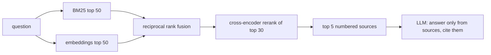

# Citemark

Ask questions about your own documents and get short answers with citations. Retrieval combines keyword
search (BM25) and embeddings, merges them with reciprocal rank fusion, and reranks with a cross-encoder.
Everything runs locally, and the repository includes a benchmark so each part of the pipeline is measured.

```
$ citemark index examples/handbook
indexed 7 chunks from examples/handbook in 7.7s -> .citemark

$ citemark ask "How many vacation days can I carry over?"
Up to 5 unused vacation days can carry over into the next year [1].
[1] time-off.md - Time off: Full-time employees get 20 days of paid vacation per calendar year, ...

$ citemark ask "Can I paste customer data into ChatGPT?"
No, customer data may never be copied to personal devices or pasted into external AI tools that are
not on the approved list in the IT portal [1].

$ citemark ask "What is the dental plan?"
I don't know based on the documents.
```

Real runs against the four-page example handbook in `examples/`. The last one matters most: when the
documents do not cover a question, it says so.

## How it works



- **Chunking** (`chunk.py`): Markdown, text and PDF. Paragraphs stay whole, headings are kept as chunk titles,
  long sections are windowed with overlap so facts near a boundary appear in both chunks.
- **Keyword search** (`bm25.py`): a small BM25 implementation; catches exact names, numbers and codes that
  embeddings blur.
- **Dense search**: `BAAI/bge-base-en-v1.5` embeddings, cosine similarity.
- **Fusion and reranking** (`index.py`): reciprocal rank fusion of the two lists, then a cross-encoder
  (`cross-encoder/ms-marco-MiniLM-L-6-v2` by default, `CITEMARK_RERANKER` to change).
- **Answering** (`answer.py`): any OpenAI-compatible model. The prompt allows only the numbered sources and
  asks for `[n]` citations; citations pointing at sources that were not given are dropped.

## Benchmark

[rag-mini-wikipedia](https://huggingface.co/datasets/rag-datasets/rag-mini-wikipedia): 3,200 passages and 918
questions. Run with `python evals/run.py`. Answering model: Qwen3-8B on vLLM, RTX 5090.

**Retrieval** (503 questions with a short answer; a hit means a retrieved passage contains the answer):

| Method | Recall@1 | Recall@3 | Recall@5 | Recall@10 | Median latency |
|---|---|---|---|---|---|
| BM25 | 48.7% | 59.2% | 61.8% | 64.6% | <1 ms |
| Embeddings | 47.3% | 61.4% | 63.6% | 66.0% | 14 ms |
| Hybrid (fusion) | 50.9% | 61.0% | 64.0% | 67.8% | 14 ms |
| **Hybrid + rerank** | **61.6%** | **67.2%** | **68.6%** | **70.0%** | 33 ms |

**Answers** (first 200 questions, including yes/no ones):

| | Accuracy | Cites a source | Says "I don't know" | Median time |
|---|---|---|---|---|
| Model alone (no documents) | 37.0% | - | - | - |
| **Citemark** | **69.0%** | 98.5% | 1.5% | 0.32 s |

**The reranker you pick matters more than whether you rerank.** Same hybrid candidates, three rerankers
(`python evals/rerankers.py ...`):

| Reranker | Recall@1 | Recall@5 | Median latency |
|---|---|---|---|
| none | 50.9% | 64.0% | - |
| BAAI/bge-reranker-base | 38.6% | 60.6% | 59 ms |
| cross-encoder/ms-marco-MiniLM-L-6-v2 | 61.6% | 68.6% | 17 ms |
| BAAI/bge-reranker-v2-m3 | 63.2% | 69.2% | 138 ms |

The first reranker I tried made results worse than no reranking at all. A popular model is not automatically a
good fit for your data; measure it. The default is the MiniLM model: nearly the accuracy of the best one at an
eighth of the latency.

Scoring is deliberately simple (does the passage or answer contain the gold answer string; yes/no answers must
start with the right word), so the numbers are comparable between methods rather than an absolute grade.

## Quick start

```bash
uv venv && uv pip install -e ".[dev]"
citemark index path/to/your/docs          # .md, .txt, .pdf
citemark ask "your question" --show-sources
```

The answering model is read from `CITEMARK_BASE_URL` (default `http://localhost:8000/v1`), `CITEMARK_MODEL` and
`CITEMARK_API_KEY`. A local vLLM server works, as does any hosted OpenAI-compatible API.

The CLI loads the embedding and reranking models on every call (several seconds). For real use, run the API,
which keeps them in memory:

```bash
CITEMARK_INDEX=.citemark uvicorn citemark.api:app --port 8080
curl -s localhost:8080/ask -H 'content-type: application/json' -d '{"question": "Who approves business class?"}'
```

The response has the answer, the cited passages, and timings. `docker build -t citemark . && docker run -p 8080:8080
citemark` serves the example handbook.

## Tests

```bash
pytest -q
```

## License

MIT
